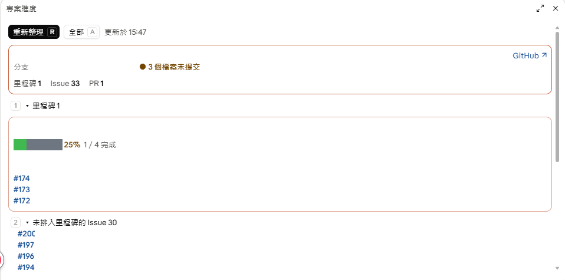

# project-progress

A [Claude Code](https://claude.com/claude-code) mod that opens a **project progress pane** beside your conversation, built automatically from your repo's GitHub data and git history. Nothing to type in by hand.

- **Milestones** with a progress bar, completion percentage, due date (overdue in red, due within a week in orange) and the open issues under each
- **Open issues** not yet assigned to a milestone, with labels in their GitHub colors
- **Open PRs** with draft and review status
- **Recently merged PRs** and **recent commits**, commit types colored by conventional-commit prefix
- Issue, PR and milestone numbers are clickable links

Works in the terminal and in the Claude Desktop app's Code tab. UI text is in Traditional Chinese (繁體中文); see [中文說明](#中文說明) below.



*The pane in the Claude Desktop Code tab. Repo name, milestone and issue titles are blanked out in this screenshot.*

## Requirements

- Claude Code **2.1.287 or newer** (tested on 2.1.295). The mod API is early access and may change between releases.
- [`gh`](https://cli.github.com/) installed and logged in (`gh auth login`), with access to the repo you are working in
- `git`
- The working directory must be a git repo with a GitHub remote. Without one, the git sections still render and the GitHub section shows the error.

## Install

```sh
claude plugin marketplace add RexWei1016/claude-project-progress
claude plugin install project-progress@claude-project-progress
```

In an already-running session run `/reload-plugins`, then:

```
/project-progress
```

In the Desktop app the command does not appear in the slash-command typeahead; type the full name and press Enter.

To try the source without installing:

```sh
git clone https://github.com/RexWei1016/claude-project-progress
claude --plugin-dir ./claude-project-progress
```

## Using the pane

| Key / control | Action |
| --- | --- |
| `r` or **重新整理** | Refresh now |
| `a` or **全部 / 精簡** | Show all rows / show the first 6 of each list |
| `1` – `5` or click a section title | Collapse / expand that section |
| Esc | Close the pane (`/project-progress` reopens it) |

Keys reach the pane while it has focus (click it, or `ctrl+x tab` in the terminal). While the pane is open it refreshes every 10 minutes.

## How it works and what it touches

- Reads data with `gh repo view`, `gh api .../milestones`, `gh issue list`, `gh pr list`, `git rev-parse`, `git status --porcelain` and `git log`, all run through the mod API's `$.process.run` in the session's working directory.
- Never writes to the repo or to GitHub. The only network traffic is `gh` talking to GitHub as you.
- Caches the last snapshot per working directory in Claude Code's local plugin store so the pane shows data immediately on the next session while it refreshes.

## Development

```sh
claude plugin validate .
```

Edit `hooks/register.tsx`; a session started with `--plugin-dir` hot-reloads on save. Type-check against the declarations the engine lays in `.claude-plugin/types/` after the first load with `tsc -p .`.

## 中文說明

這是一個 Claude Code mod，在對話旁開一個「專案進度」面板，內容從目前 repo 的 GitHub 資料與 git 歷史自動產生：

- 里程碑：進度條、完成百分比、到期日（逾期紅色、一週內橘色）、底下的開啟 Issue
- 未排入里程碑的 Issue，標籤用 GitHub 設定的顏色
- 進行中的 PR（草稿、審核狀態）
- 最近合併的 PR 與最近提交（依 feat／fix／docs 等前綴上色）
- 編號都是可以點的連結

需要先安裝並登入 `gh`，工作目錄必須是有 GitHub remote 的 git repo。安裝指令同上；安裝後在 session 裡輸入 `/project-progress`。按 `r` 重新整理、`a` 切換全部／精簡、`1` 到 `5` 收合或展開各區塊、Esc 關閉面板。

## License

MIT
